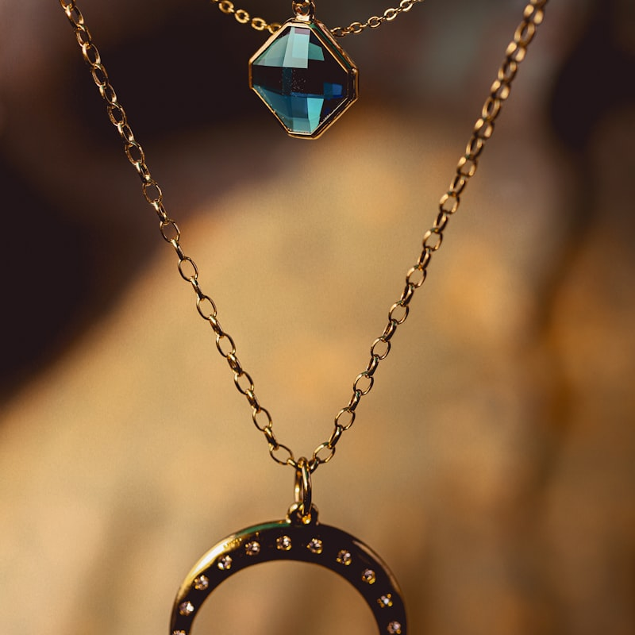

# Vanegas Royal — Joyería e-commerce premium

Tienda en línea de joyería de lujo con estética **dark + oro**: catálogo, ofertas, carrito, checkout listo para conectar pasarela de pago y panel de administración para gestionar productos y pedidos.

<p>
  
  
  
  
  
</p>

<p align="center">
  
  
  
  
</p>

## Características

**Tienda**
- Portada, catálogo (`tienda.php`), detalle de producto y sección de ofertas.
- Carrito persistente en el navegador (localStorage).
- Checkout con el pedido **validado en el servidor** y guardado en la base de datos, más envío del resumen por WhatsApp.
- Estructura de pasarela de pago preparada (Wompi / Mercado Pago) que se activa desde la configuración.
- Animaciones con GSAP + ScrollTrigger y tipografía Cinzel / Jost.
- Preguntas frecuentes y contacto.

**Panel de administración** (`/admin`)
- Dashboard.
- CRUD completo de productos con subida de imagen.
- Gestión de ofertas y de pedidos.

## Stack

| Capa | Tecnología |
|------|------------|
| Backend | PHP puro (sin framework) + PDO |
| Base de datos | SQLite (`data/vanegas.sqlite`, generada por el seed e ignorada por git) |
| Frontend | Tailwind CSS (CDN) + Alpine.js |
| Animación | GSAP 3 + ScrollTrigger |

## Estructura del proyecto

```
Vanegas/
├── index.php, tienda.php, producto.php, ofertas.php   # storefront
├── carrito.php, checkout.php                          # carrito y pedido
├── faq.php, contacto.php
├── admin/            # dashboard, productos (CRUD), ofertas, pedidos
├── config/           # config.php y conexión a la BD
├── includes/         # header, footer y helpers
├── database/
│   └── seed.php      # esquema (productos, ofertas, pedidos) + datos demo
└── assets/           # css, js e imágenes de productos
```

## Cómo correrlo en local

Requisitos: PHP 8 con la extensión `pdo_sqlite` habilitada.

```bash
# 1. Clonar
git clone https://github.com/burgosdavid057-art/vanegas-royal.git
cd vanegas-royal

# 2. Crear la base de datos con datos demo (solo la primera vez o para reiniciarla)
php database/seed.php

# 3. Levantar el servidor
php -S localhost:8000
```

Abrir http://localhost:8000. El panel queda en http://localhost:8000/admin/login.php.

**Logo:** coloca el logo en `assets/img/logo.png` (nav, hero y login del admin). Si no existe, el sitio muestra un texto de respaldo.

## Configuración antes de producción

En `config/config.php`:
- Número de WhatsApp y datos de contacto (correo, dirección, redes).
- Pasarela de pago: `PAYMENT_ENABLED` y `PAYMENT_PROVIDER`, con las llaves reales del comercio.

## Acceso de demostración

| Usuario | Contraseña |
|---------|------------|
| `admin` | `vanegas2025` |

Son credenciales **solo de demostración**; cámbialas en `config/config.php` antes de cualquier despliegue real.

## Autor

**David Burgos** — Desarrollador full-stack + IA, Medellín (Colombia).

- Portafolio: [davidburgos.dev](https://davidburgos.dev)
- GitHub: [@burgosdavid057-art](https://github.com/burgosdavid057-art)
- LinkedIn: [David Burgos](https://www.linkedin.com/in/david-burgos-ab673433a/)
